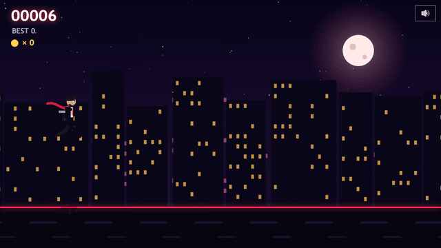
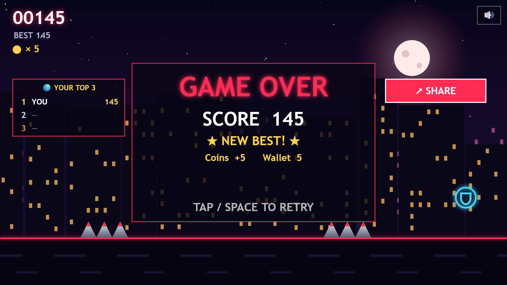

# Shadow Dash

**A free neon endless runner. Dodge, slide, double-jump. Plays instantly in your browser - desktop and phone.**

### ▶ [Play now](https://pulkitkhatter.github.io/shadow-dash/)

## Features
- Fast one-button-style runner: jump (double jump), slide, fast-fall
- Obstacles: crates, spikes, drones (slide under), tall walls (double jump)
- Power-ups: Shield and Magnet
- 4 skins unlocked with coins, saved on your device
- 7 languages: English, Hindi, Spanish, Portuguese, French, German, Indonesian
- Installable on phones (PWA) and works offline
- Share your score with one tap

## Controls
| Action | Keyboard | Touch |
|---|---|---|
| Jump / double jump | Space, Up, W | tap right side |
| Slide | Down, S | tap left side |
| Pause / mute | P, M | - |

Single HTML5 canvas file, no dependencies. All art and sound are generated in code.
